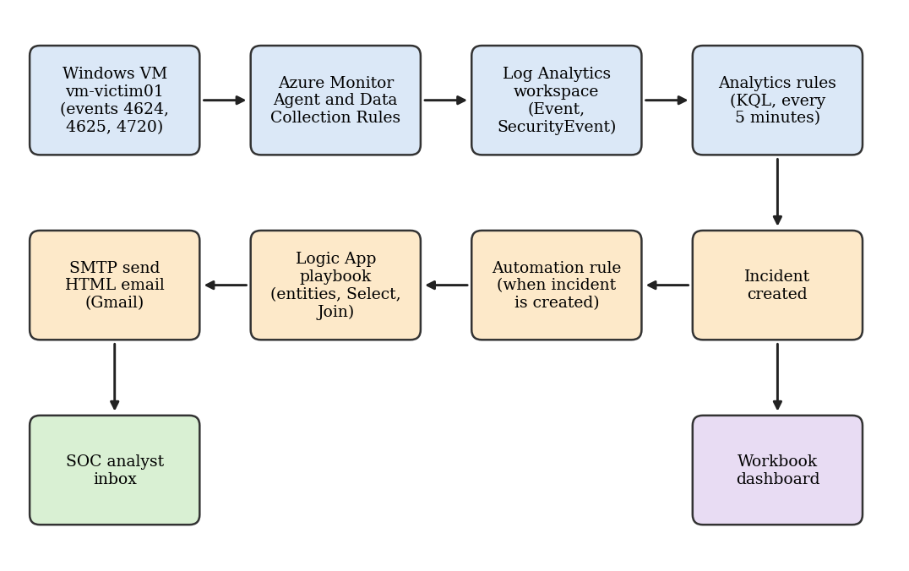
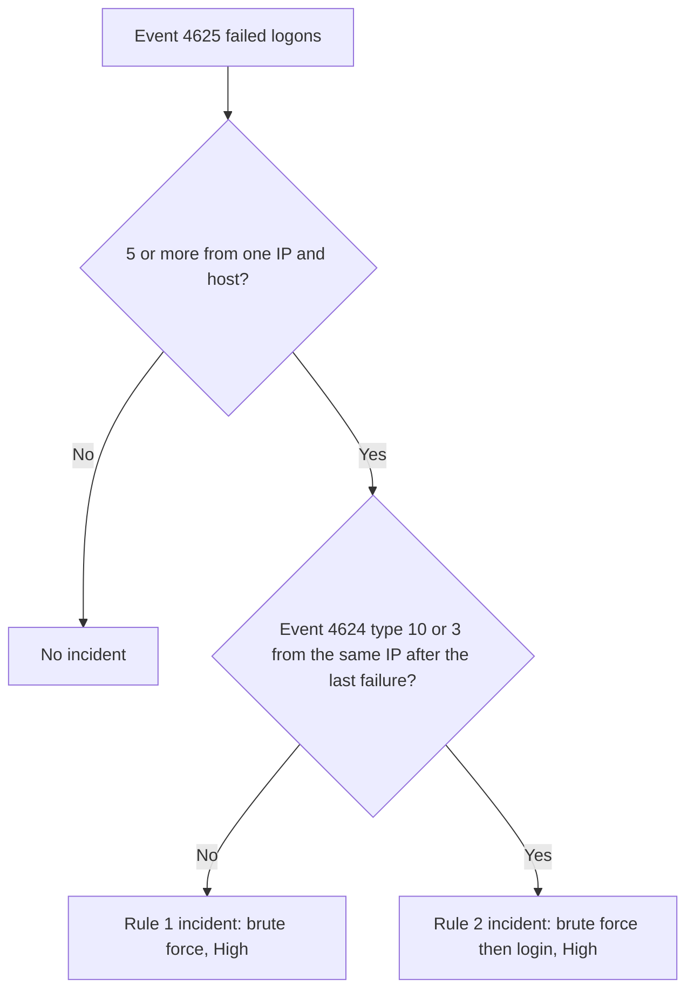
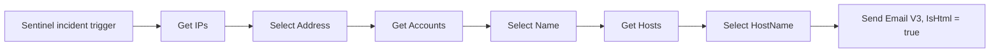
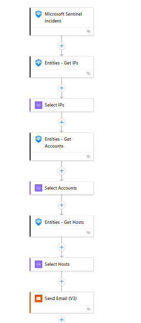
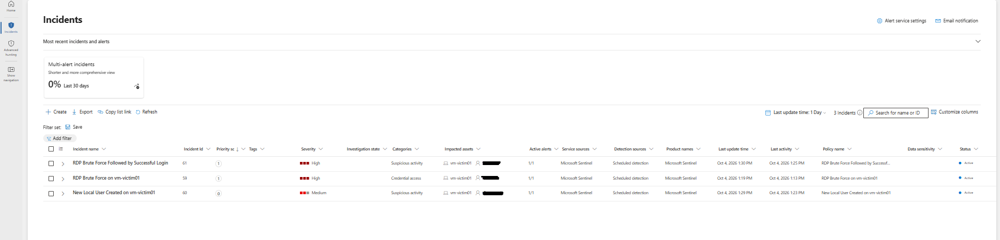
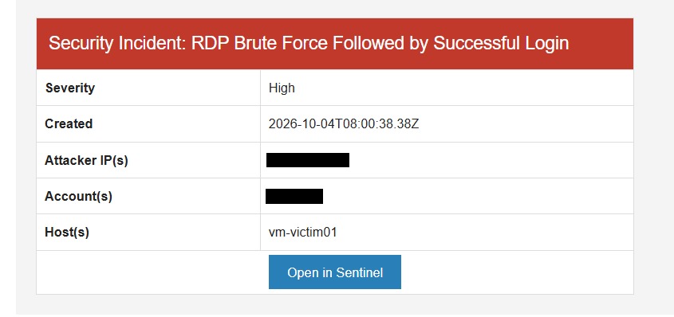
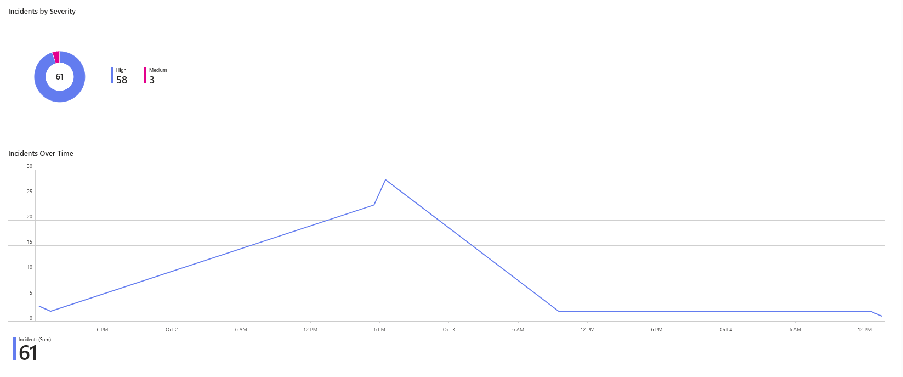

# Automated SIEM Security Email Alerting using Microsoft Sentinel

A fully automatic pipeline that detects Windows security incidents in **Microsoft Sentinel** and sends a customised HTML alert email, with no analyst action.

**Stack:** Microsoft Sentinel · Azure Monitor Agent · KQL · Logic Apps · SMTP · Sentinel Workbooks

> M.Tech dissertation, VIT Bhopal University (2026). The full write-up is in [REPORT.md](REPORT.md).

## Why this project

SIEM alert emails are often fixed in format, so SOC analysts reformat them by hand before sending them to clients. The base paper (Chi et al., ICoICT 2023) removes the formatting work with a web tool, but an analyst still has to export logs, upload them and fill a form for every alert. This project removes that manual step: an incident creates the email by itself.

## Architecture

  

1. The Windows VM `vm-victim01` sends security events (4624, 4625, 4720) to a Log Analytics workspace through the Azure Monitor Agent.
2. Three scheduled KQL analytics rules run every 5 minutes and raise incidents.
3. An automation rule runs the Logic App playbook on every new incident.
4. The playbook reads the IP, account and host entities and sends a styled HTML email over SMTP.
5. A workbook summarises incidents by severity, time, rule and attacker IP.

## Detection rules

| # | Rule | Severity | Logic |
| --- | --- | --- | --- |
| 1 | RDP Brute Force on vm-victim01 | High | 5 or more failed logons (4625) from the same IP, account and host |
| 2 | RDP Brute Force Followed by Successful Login | High | 5 or more failed logons, then a successful logon (4624, type 10 or 3) from the same IP |
| 3 | New Local User Created on vm-victim01 | Medium | Any event 4720 (user account created) |

## Playbook

  

## Output

An incident is raised for each rule, and the playbook emails the details.

  
    
  

The workbook gives an overview of the incidents.

  

## Results

| Measure | Result |
| --- | --- |
| Use cases tested | 3 of 3 produced an incident and an email |
| Incident to email | about 1 minute or less, no human step (playbook runs take about 4 to 10 s) |
| Event to incident | several minutes (agent upload plus the 5 minute rule schedule) |
| Manual process in the base paper | about 8 to 13 minutes per alert (author's estimate) |
| Duplicate emails | removed with 1 hour suppression and alert grouping by entity |
| Missing event 4720 | fixed with the Windows Security Events via AMA connector |

## Repository layout

| Path | Contents |
| --- | --- |
| `queries/` | KQL queries for the analytics rules and dashboard |
| `playbook/` | Logic App playbook files |
| `screenshots/` | Screenshots used in this README and the report |
| `REPORT.md` | Full project report with literature review, method and results |

## How to reproduce

1. Create a resource group, a Log Analytics workspace and enable Microsoft Sentinel.
2. Deploy a Windows VM with RDP enabled and install the Azure Monitor Agent.
3. Add the **Windows Security Events via AMA** connector so that events 4624, 4625 and 4720 reach the `SecurityEvent` table.
4. Create the three analytics rules from `queries/` (run every 5 minutes, look back 1 hour, map IP, account and host entities).
5. Create the Logic App playbook with the actions above and an SMTP connection.
6. Create the automation rule "Email on new incident" and give Sentinel the Automation Contributor role.
7. Generate failed RDP logins and a new local user on the VM and check your inbox.

## Limitations

- Each use case was run once on one lab VM, so the timings are single measurements.
- Gmail SMTP with an app password is for a lab only; use a production mail service otherwise.
- The automation rule emails every incident; production use should filter by severity.
- Collection uses the "AllEvents" setting, which is heavy and should be reduced after testing.

## Author

Sandeep S Raghav, M.Tech (Cyber Security and Digital Forensics), VIT Bhopal University. Supervisor: Dr. Hariharasitaraman S.
